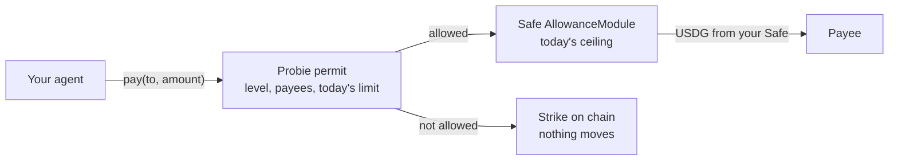

# Probie

[](https://github.com/probielabs/probie/actions/workflows/test.yml)
[](https://repo.sourcify.dev/4663/0xe475F59873Eb3EAfCf42b70dF64DcABd071715CB)
[](LICENSE)

**A learner's permit for AI agents on Robinhood Chain.**

Your agent spends from your own Safe, under a daily limit it earns: $5 a day to start, more after every clean
stretch. A payment the permit doesn't allow is blocked on chain and recorded as a strike. Your funds stay in your Safe:
nothing is ever deposited with Probie, and Safe's audited AllowanceModule caps what can move in a day, whatever
happens above it.

- Site and live show: https://probielabs.com
- X: https://x.com/ProbieLabs

This repo holds the Probie contracts, the only code that touches your funds. Both contracts are deployed and
verified on Robinhood Chain. The site and the live show run on our own servers.



## Documentation

| | |
|---|---|
| [How it works](docs/how-it-works.md) | The pieces, one payment step by step, levels, strikes, and who can do what. |
| [Integrate](docs/integrate.md) | Open a permit from your Safe, pay from your agent, read permits for a dashboard. |
| [Example](examples/) | One payment with viem, runnable read-only against the live show. |
| [Security](SECURITY.md) | The hard cap, the audit status, known limits, and how to report a bug. |
| [Deployments](deployments/robinhood.json) | Every address, the deploy transaction and the verification links. |

## Deployed on Robinhood Chain (chain id 4663)

| Contract | Address |
|---|---|
| `ProbieFactory` | `0xe475F59873Eb3EAfCf42b70dF64DcABd071715CB` |
| `ProbiePermit` (implementation) | `0x754Ecd0dCf43249A72057941280060a4Cef546a1` |
| The live show's Safe | `0x27057A0a4048D08cf513B406cE17b6F5adFe12c1` |
| The live show's permit | `0xF9e98d1E483920F8484A4c47ecf094F982771511` |

The factory was deployed in block 116847264 (17 Nov 2026).

## Verify it yourself

Both contracts are verified on Sourcify with an **exact match**: compiling the sources in this repo with the settings
in `foundry.toml` gives the bytecode that is on chain, metadata included.

- https://repo.sourcify.dev/4663/0xe475F59873Eb3EAfCf42b70dF64DcABd071715CB
- https://repo.sourcify.dev/4663/0x754Ecd0dCf43249A72057941280060a4Cef546a1

The same source shows on the Robinhood Chain explorer, under each address's Contract tab:
https://robinhoodchain.blockscout.com/address/0xe475F59873Eb3EAfCf42b70dF64DcABd071715CB

To build and test locally ([Foundry](https://getfoundry.sh)):

```shell
git clone --recurse-submodules https://github.com/probielabs/probie
cd probie
forge build
forge test
```

The libraries are pinned submodules: OpenZeppelin Contracts `v5.1.0`, Safe Smart Account `v1.4.1` and forge-std
`v1.17.0`.

## Security

Probie's own contracts are small and have not had an external audit. The hard cap does not depend on them: the
owner's AllowanceModule allowance (Safe's audited release) limits what the permit can move per UTC day, so a bug in
Probie can at worst spend up to the ceiling you set. Set the ceiling to what you can lose in a day. Found something?
Message https://x.com/ProbieLabs.

## Contracts

| File | What it does |
|---|---|
| `src/ProbiePermit.sol` | One EIP-1167 clone per (Safe, agent). It is the Safe's AllowanceModule delegate. `pay(to, amount)` checks the level rules. When they pass, it pays through `executeAllowanceTransfer(safe, USDG, to, amount, 0, 0, permit, "")`; the empty signature makes the module authenticate `msg.sender`. When they fail, it records a strike and returns `false` without reverting, so the strike stays on chain. The Safe is the owner: it approves payees, freezes, and replaces the agent key. `check()` and `status()` are free reads for agents and the board. |
| `src/ProbieFactory.sol` | `create(agent, startLevel, payees, salt)` is called by the Safe itself, so nobody can open a permit on someone else's Safe. `predict(safe, salt)` gives the clone's address ahead of time. Emits `PermitCreated` for the board. |
| `src/interfaces/IAllowanceModule.sol` | The two module calls the permit makes. |
| `script/ProbieSetup.sol` | Opens a 1-of-1 Safe, builds the one-batch setup, and runs any call as a Safe transaction signed by the owner key. Holds the live Robinhood Chain addresses. The scripts and the tests both use it. |
| `script/Deploy.s.sol` | Deploys `ProbieFactory` for the live module and USDG. |
| `script/SetupDemo.s.sol` | Opens a demo Safe and permit with the one-batch setup. |

Live addresses (Robinhood Chain):

- AllowanceModule 0.1.1: `0xAA46724893dedD72658219405185Fb0Fc91e091C`
- USDG: `0x5fc5360D0400a0Fd4f2af552ADD042D716F1d168` (6 decimals)
- Safe L2 1.4.1: `0x29fcB43b46531BcA003ddC8FCB67FFE91900C762`
- SafeProxyFactory 1.4.1: `0x4e1DCf7AD4e460CfD30791CCC4F9c8a4f820ec67`
- MultiSendCallOnly 1.4.1: `0x9641d764fc13c8B624c04430C7356C1C7C8102e2`

## Rules

A day is a UTC day (`block.timestamp / 86400`), the same day the ceiling resets on. Amounts are in USDG.

| Level | Daily limit | New payees | To move up |
|---|---|---|---|
| L0 | $5 | none (approved only) | 3 clean days |
| L1 | $25 | none | 7 clean days |
| L2 | $100 | up to $10 a day | 14 clean days |
| L3 | $500 | up to $25 a day | 30 clean days |
| L4 | the ceiling | up to $25 a day | top level |

- **Payees.** Approved payees are the owner's list. Any other address is a new payee, every time. Payments to new
  payees count against the new-payee cap, which sits inside the daily limit.
- **The ceiling.** The owner's AllowanceModule allowance for the permit: an amount per UTC day (`resetTimeMin` 1440,
  `resetBaseMin` at a UTC midnight). Every payment must also fit what is left of it. A ceiling that does not reset
  every 1440 minutes from a UTC midnight (an hourly period, no reset, or a base at "now") could let more than the
  ceiling move in one UTC day, so `pay()` and `check()` revert with `BadCeiling` until the owner sets a UTC-day one.
- **Clean days.** Counted from the permit's start, its last strike or its last level-up. Level-ups apply lazily on
  any call and catch up across several levels; each step restarts the count at the moment that level was reached.
- **Strike.** A blocked `pay()`, for one of these reasons (`check()` returns the same codes):

  | Code | Reason |
  |---|---|
  | 1 `OVER_LIMIT` | over the level's daily limit |
  | 2 `OVER_CEILING` | over what is left of the ceiling today |
  | 3 `PAYEE_NOT_ALLOWED` | a new payee at L0-L1 |
  | 4 `NEW_PAYEES_PAUSED` | a new payee within 7 days of a strike |
  | 5 `OVER_NEW_PAYEE_CAP` | over the level's new-payee cap |

  Nothing moves, the clean-day count restarts, and new payees pause for 7 days. Going over the limit or the ceiling a
  second time within 7 days drops one level (never below L0). Payee strikes (codes 3-5) never drop the level.
- **Frozen.** The owner's switch: `pay()` reverts and nothing is recorded (`check()` returns 6 `FROZEN`). Frozen days
  are not clean days: level-ups earned before the freeze are applied when it starts, the clean-day clock pauses while
  frozen, and it resumes from the same count on unfreeze. A freeze is not a strike, so it never resets the count.
- **Not the agent's fault, so not a strike:** no ceiling set or the ceiling deleted (`NoCeiling` revert), a ceiling
  that is not per UTC day (`BadCeiling` revert), the Safe short of USDG, or the delegate removed from the module.
  These revert.

## The one-batch setup

The owner's Safe runs one `execTransaction` that delegatecalls `MultiSendCallOnly.multiSend` with four calls:

1. `safe.enableModule(AllowanceModule)` (skipped when the Safe already runs the module, for a second permit);
2. `factory.create(agent, startLevel, payees, salt)`; the Safe is `msg.sender`, so the permit belongs to it;
3. `AllowanceModule.addDelegate(permit)`, with `permit = factory.predict(safe, salt)`;
4. `AllowanceModule.setAllowance(permit, USDG, ceiling, 1440, <today's UTC midnight in minutes>)`.

`ProbieSetup.setupBatch` builds it. It takes the module and token from the factory's implementation, so the ceiling
always lands on the token the permit pays in.

## Trust model

- **The ceiling is the audited hard cap.** Whatever the permit's own code does, it can never move more than the
  owner's AllowanceModule allowance per UTC day: the module, not the permit, holds that check, and it is Safe's
  audited release. A bug in Probie can at worst spend up to the ceiling. Set the ceiling to what you can lose in a day.
- The permit's levels are the soft rules inside that cap. They are what the board shows and what the tests and
  invariants check.
- The Safe owner can always freeze the permit, replace the agent key, change payees, change or delete the ceiling
  (`setAllowance` / `deleteAllowance`), remove the delegate, or disable the module. Each is an ordinary Safe
  transaction.
- The agent key can only call `pay()`. It cannot change its level, payees, ceiling or agent.

## Board indexing

The factory takes any caller as the Safe, so a contract that only fakes the Safe interface can open a permit whose
`Paid` events move no USDG. Funds are never at risk, but the board must not show that activity. Its indexer:

- keeps only permits from the official factory's `PermitCreated`;
- keeps a permit only when its Safe's code hash is the SafeProxy 1.4.1 runtime hash and the proxy's own `masterCopy()`
  (selector `0xa619486e`) returns the Safe or Safe L2 1.4.1 singleton (a code-hash check alone lets a real proxy point
  at a fake singleton);
- counts volume and payees only from a USDG `Transfer(safe, to, amount)` log in the same transaction as each `Paid`;
- reads the current level from `status()`: `LevelChanged` collapses a catch-up and nets out changes inside one call.

`test_F3_fakeSafeIsTellableFromARealSafe` pins the two facts these checks rely on.

## Nonce limit

The AllowanceModule keeps a `uint16` transfer nonce per (Safe, delegate, token). Plan on **65,534 transfers per
permit**, then open a new permit clone (a new salt) and move the ceiling to it.

What the deployed 0.1.1 actually does: it is compiled with solc 0.7.6 and has no nonce check, so the nonce wraps from
65,535 to 0 and payments go on. With the empty-signature path the nonce guards nothing, so the wrap is harmless
(`test_moduleNonceWrapsOn011`). AllowanceModule 1.0.0 added `require(nonce != type(uint16).max)`, which stops a
delegate at 65,534 transfers; keeping to that number keeps Probie correct on either release. The current nonce is
`getTokenAllowance(safe, permit, USDG)[4]`.

## Tests

The suite runs against the real Safe 1.4.1 contracts (`lib/safe-smart-account`, tag `v1.4.1`) and the exact
AllowanceModule 0.1.1 source, vendored unchanged in `test/vendor/allowance/` (safe-modules tag `allowance/v0.1.1`,
commit `edf7af00279b3af223b012d24064da62247ee843`). `foundry.toml` builds that one folder with solc 0.7.6 and the
optimizer off, like the release. Its runtime code, minus the metadata tail, equals the code deployed at
`0xAA46…091C` on Robinhood Chain (14,855 bytes). `forge fmt` skips the vendored folder.

| File | What it covers |
|---|---|
| `test/ProbiePermit.t.sol` | Unit tests and a fuzz test against a mock module (fast). |
| `test/Integration.t.sol` | The real stack, deployed locally: a 1-of-1 Safe owned by a test key runs the one-batch setup as a signed `execTransaction`; payments, every strike reason, level-ups and catch-up, demotion, the ceiling, UTC-midnight resets, freeze, and owner actions as Safe transactions (`setPayee`, `setFrozen`, `setAgent`, `setAllowance` and `deleteAllowance` mid-day). |
| `test/invariant/PermitInvariant.t.sol` | A handler over the real stack (the agent pays approved or new payees $0-600, time moves 0-3 days, the owner changes payees, freezes and sets new ceilings), run from L0 and from L2. Per UTC day: outflow within the limit of the highest level seen and within the highest ceiling set; new-payee outflow within the cap, and zero at L0-L1. Always: a `false` return moves nothing; nothing moves while frozen; strikes equal `false` returns; the level is at most 4; every payment the permit allows goes through the module for the exact amount. |
| `test/poc/ReviewPoC.t.sol` | Regression tests from the 18 Nov review: a ceiling that is not per UTC day is refused, a freeze pauses the clean-day clock, and a fake Safe is told apart from a real one. |
| `test/Fork.t.sol` | Robinhood Chain fork: the live module equals the vendored build; a Safe from the live factory and Safe L2 singleton runs the one-batch setup against the live module and USDG, then makes one payment and takes one strike. |

```shell
forge test                                                     # everything offline; the fork suite is skipped
forge test --match-path test/invariant/PermitInvariant.t.sol   # invariants only: 256 runs x 64 calls
PROBIE_FORK=true PROBIE_FORK_BLOCK=<recent block> forge test --match-path test/Fork.t.sol
```

The public RPC is rate-limited and not an archive node. It only serves recent state (a block from about 30 minutes
earlier already fails), so the fork block is pinned per run: `PROBIE_FORK_BLOCK`, or the head when the fork opens if
it is unset. Run the fork suite by hand, not in a loop, and never with fuzz or invariant tests.

## Deploy

Nothing here broadcasts unless `--broadcast` is passed. Keys are read from environment variables by name and never
logged. Pass them for the one command only, and never write them into a file.

1. **Dry-run on a local fork**, with throwaway keys:

   ```shell
   anvil --fork-url https://rpc.mainnet.chain.robinhood.com --fork-block-number <recent block> --port 8645
   cast rpc --rpc-url http://127.0.0.1:8645 anvil_setBalance <throwaway address> 0x16345785D8A0000
   PROBIE_DEPLOYER_KEY=<throwaway> forge script script/Deploy.s.sol --rpc-url http://127.0.0.1:8645 --broadcast
   PROBIE_OWNER_KEY=<throwaway> PROBIE_FACTORY=<factory> PROBIE_AGENT=<agent> \
   PROBIE_PAYEES=<a>,<b> PROBIE_CEILING=30000000 PROBIE_START_LEVEL=0 PROBIE_SALT=<bytes32> \
     forge script script/SetupDemo.s.sol --rpc-url http://127.0.0.1:8645 --broadcast
   ```

   Then stop anvil (PID from `lsof -tiTCP:8645 -sTCP:LISTEN`) and delete `broadcast/` and `cache/*.s.sol/`, so local
   runs are never mistaken for live ones.

2. **Review** the diff and the test results.
3. **Live:** a freshly funded deployer. Run
   `forge script script/Deploy.s.sol --rpc-url robinhood` to simulate, then the same with `--broadcast` to send. The
   script checks that the module and USDG exist on the target chain, and logs the factory and implementation.
4. **Demo permit:** `script/SetupDemo.s.sol` with a fresh demo wallet's key as `PROBIE_OWNER_KEY` (it pays the gas).
   It creates a new 1-of-1 Safe L2 (salt nonce = `PROBIE_SALT`) and runs the one-batch setup. Fund the Safe with USDG
   afterwards.

## License

MIT. See `LICENSE`.
