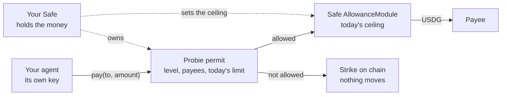
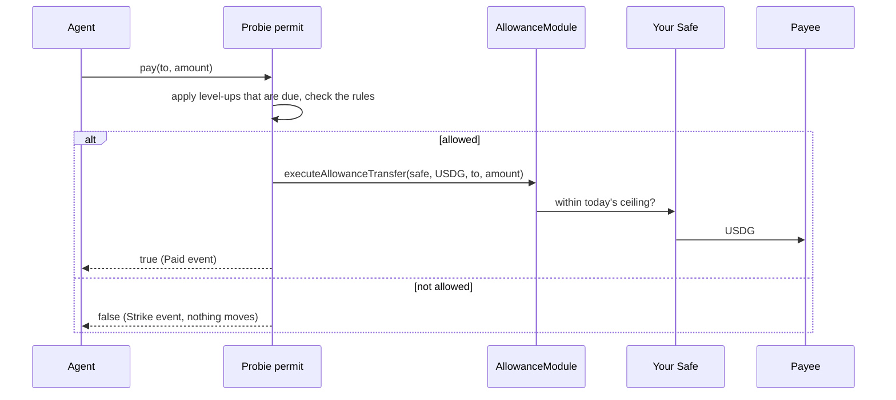

# How Probie works

Probie gives an AI agent a learner's permit for its owner's money. The money stays in the owner's Safe. The agent
gets its own key and a permit that decides, payment by payment, what that key may spend. A new agent starts small
and earns bigger limits by staying clean. Anything the permit doesn't allow is blocked, nothing moves, and the
attempt is recorded on chain as a strike.

## The pieces

| Piece | Who runs it | What it decides |
|---|---|---|
| Your Safe (Safe 1.4.1) | You | Holds the USDG. Owns the permit. |
| AllowanceModule 0.1.1 | Safe's audited module, already live on Robinhood Chain | The ceiling: how much the permit may move per UTC day, at most. |
| Probie permit | This repo, one clone per (Safe, agent) | The level rules inside that ceiling: who the agent may pay, and how much today. |
| Your agent | You | Holds a key that can only call `pay()`. |

## One payment

`pay()` returns `false` instead of reverting when the rules say no, so the strike stays on chain. It reverts only when
the payment can't be judged at all: the permit is frozen, the caller isn't the agent, or the owner's ceiling is
missing or not set per UTC day.

## Levels

| Level | Daily limit | New payees | To move up |
|---|---|---|---|
| L0 | $5 | none (approved only) | 3 clean days |
| L1 | $25 | none | 7 clean days |
| L2 | $100 | up to $10 a day | 14 clean days |
| L3 | $500 | up to $25 a day | 30 clean days |
| L4 | the ceiling | up to $25 a day | top level |

- A day is a UTC day, the same day the ceiling resets on.
- **Approved payees** are the owner's list. Any other address is a **new payee**, every time.
- **Clean days** count from the permit's start, its last strike or its last level-up. Level-ups apply on the next call
  to the permit (`pay()`, or `sync()`, which anyone may call), and catch up across several levels at once.
- The owner picks the start level, from L0 to L2.
- Every payment must also fit what is left of the owner's ceiling, at every level.

## Strikes

| Code | Reason |
|---|---|
| 1 `OVER_LIMIT` | over the level's daily limit |
| 2 `OVER_CEILING` | over what is left of today's ceiling |
| 3 `PAYEE_NOT_ALLOWED` | a new payee at L0 or L1 |
| 4 `NEW_PAYEES_PAUSED` | a new payee within 7 days of a strike |
| 5 `OVER_NEW_PAYEE_CAP` | over the level's new-payee cap |

A strike moves nothing. The clean-day count restarts and new payees pause for 7 days. Going over the limit or the
ceiling a second time within 7 days drops one level, never below L0. Payee strikes (codes 3 to 5) never drop the
level.

There are no judgment calls: the permit only checks hard rules, so a strike always means a payment broke one. If the
payee was legitimate, the owner approves it and the agent pays.

## Who can do what

| Key | Can |
|---|---|
| The Safe (its owners) | Approve or remove payees (`setPayee`), freeze and unfreeze (`setFrozen`), replace the agent key (`setAgent`). Through the AllowanceModule: change or delete the ceiling, remove the permit as a delegate, or disable the module. Each is an ordinary Safe transaction. |
| The agent | Call `pay()`. Nothing else: it cannot change its level, its payees, the ceiling or itself. |
| Anyone | Read `check()` and `status()`, and call `sync()`. |

While frozen, `pay()` reverts and nothing is recorded. Frozen days are not clean days: the clean-day clock pauses
and resumes from the same count on unfreeze. A freeze is not a strike.

## The worst case

The ceiling is the hard cap, and it does not depend on Probie's code: the AllowanceModule, Safe's audited release,
holds that check. A bug in the permit could at worst spend up to the ceiling in a UTC day. Set the ceiling to what
you can lose in a day.
